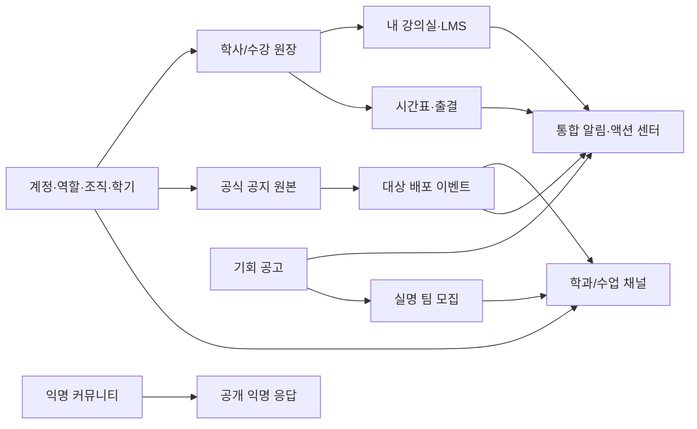

# 통합 기능 연결 설계 — v1.0 보완안

**설계 제안**이다. [DEC-001~014](../11_DECISION_LOG.md)의 독립 플랫폼·통합 경험 방향을 보존한다. 기존 학교 시스템 API, SSO 또는 개인 데이터를 실제로 연동한다는 뜻이 아니다.

## 공통 원장과 경계

`profiles`는 표시 프로필, `role_assignments`는 권한, 학적/입학 원장은 신분과 업무 사실을 기록한다. 학생·교수·조교·관리자는 같은 인증 체계를 사용할 수 있지만 업무 범위는 별도로 검사한다. 지원자와 기업은 별도 신분 범주다. 장기 실운영 신원 공급원은 미정. 익명 글 내부 소유권은 운영용 비공개 영역에 있고 검색/실명 프로필/AI 추천으로 전달하지 않는다.

## 데이터 이벤트 계약

| 이벤트 | 발생 원장 → 소비 화면 | 필수 참조/멱등성 | 실패·변경 동작 |
|---|---|---|---|
| `notice.published/revised/archived` | 공식 원본→대상 학과·학년·수업 채팅 카드/개인 알림 | `notice_id, revision, destination_id, event_type`; 권한 스냅샷과 현재 권한 재검사 | 배포 실패 재시도; 원본은 보존; 철회·정정 시 카드가 최신 상태를 연다. |
| `academic_affiliation.changed` | 학적 원장→학과/학년 채널·공지·검색·서명 URL | `student_id, effective_at, version` | 이전 학과 새 조회/실시간 구독 차단; 과거 게시물 처리 정책은 미정. |
| `enrollment.confirmed/cancelled` | 수강 원장→시간표·강의실·LMS·출결·라이브 권한 | `student_id, offering_id, term_id, version` | 취소 후 강의실·파일·라이브 접근 회수; 성적·기록 보존은 운영정책. |
| `assignment.published/due_changed/submitted` | 강의실→홈 액션·알림 | `assignment_id, revision, recipient` | 마감 변경 시 기존 작업 갱신, 중복 알림 접기. |
| `opportunity.published/revised/closed` | 기회 센터→개인 관련 공고·체크리스트·모집 | `opportunity_id, revision, audience` | 원문 변경/마감 표시; 학생 자기 제출기록을 기관 접수로 승격하지 않음. |
| `recruitment.application.accepted` | 실명 모집→팀 멤버십·채팅·알림 | `application_id, status_version` | 정원 경합 시 원자적 승인; 익명 활동 ID와 연결 금지. |
| `live_session.started/ended` | 분반→수강생 라이브 표시·질문함 | `offering_id, session_id` | 미수강생 토큰 차단, 종료 후 표시 제거. |
| `library.loan_due` / `reservation.confirmed` | 도서관 원장→개인 알림·액션 | `loan/reservation_id, version` | 원장 접근권 없으면 알림 생성 금지; 민감 제목 미리보기 정책 결정. |
| `service_request.updated` | 민원/상담→본인 처리 현황 | `request_id, version` | 고충 내용은 일반 알림/AI/검색에 싣지 않음. |
| `credential.issued/revoked` | 이수·비교과 원장→디지털 배지·본인 포트폴리오 | `credential_id, issuer_id, evidence_id, version` | 실제 발급권이 없으면 시연 배지로만 표시; 철회 후 외부 공유 상태는 미확인. |

## 검색·알림·AI 통합

- 검색 인덱스는 공개 콘텐츠(학교/학과/공고/도서 서지)와 개인 콘텐츠(본인 강의·신청·작업)를 분리한다. 검색 결과도 요청 시점 권한을 다시 평가한다.
- 알림은 원본 엔터티 ID와 `dedupe_key`를 가진 카드다. 공식/학생 작성/AI 요약 배지를 별도로 표시한다. 삭제·개정·권한 상실 후 오래된 알림이 비공개 자료를 유출하지 않도록 열람 시 재검사한다.
- 액션 센터의 기한·대상·상태는 **규칙 기반 서비스 쿼리**에서 계산하고 AI는 설명만 생성한다. 성적/출결/합격/장학 자격을 모델 출력으로 판정하지 않는다. [기존 AI 계약](../02_FRD.md).
- 외부 장학 공고의 개인 상태는 `saved_opportunities`에만 있고 기관 제출 결과와 동기화된 것처럼 보이지 않는다. 공모전은 같은 `opportunity_id`에서 실명 `recruitments`로 이어진다.
- 교수 화면 공유는 분반 `live_sessions`, 수강자 `enrollments`, 질문 `course_questions`를 공통 FK로 연결한다. 원본 PPT/PDF는 자료 권한으로 독립 열람한다. [기존 강의실 계약](../02_FRD.md).

## 장기 운영 경계

실제 학생정보·LMS·캠퍼스락·도서관·입학·발급기관과 동기화할 경우 어느 원장이 최종 권위인지, 이벤트 지연/불일치 처리, 데이터 이전, 계약·권한을 먼저 결정해야 한다. 현재 PRD는 실제 연동을 금지하므로 시연/기획 단계에서는 **내부 가상 원장**만 연결한다. 외부 공개 콘텐츠는 원본 URL과 출처 시각을 보유하고, 공식 DB를 가진 것처럼 보이게 하지 않는다.
